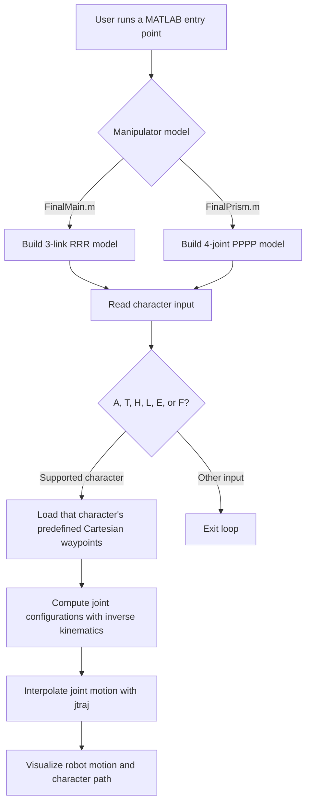

# Architecture

The project contains two standalone MATLAB entry points. Each builds a robot model, accepts a character selection, and dispatches to a character-specific waypoint routine. The selected routine solves inverse kinematics for the stroke points, interpolates between joint configurations, and plots the resulting robot motion and path.

## Components

- **Entry points and model setup:** `FinalMain.m` builds a three-link revolute `SerialLink`; `FinalPrism.m` builds a four-joint prismatic `SerialLink`.
- **Character dispatch:** Each script reads console input and calls a routine for one of the six supported letters. Both scripts accept uppercase and lowercase letters.
- **Path representation:** Each letter routine defines its drawing as Cartesian waypoint coordinates in the script.
- **Motion generation:** The routines use the Robotics Toolbox inverse-kinematics and `jtraj` functions to generate joint configurations and interpolated motion.
- **Visualization:** Robotics Toolbox plotting shows the manipulator movement; MATLAB 3D plotting displays the character stroke path.

The two models are alternative simulations, not stages connected in series. Their joint types, coordinate ranges, and plotting behavior differ. The repository does not include hardware communication or a general-purpose character/font parser.
